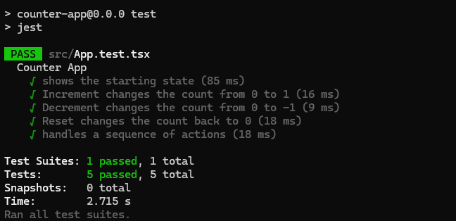
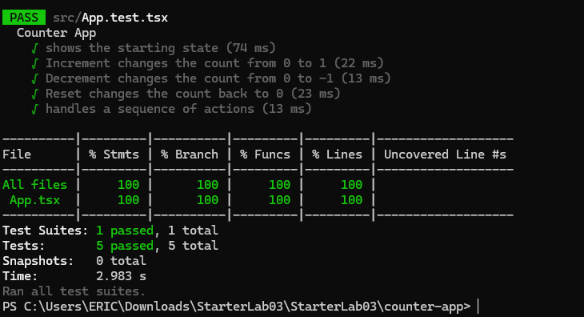

# Lab: Exploratory and White Box Testing

## Topics

- Exploratory testing
- White box testing
- Statement coverage
- Code coverage
- React component testing

## Learning Objectives

- Perform a focused exploratory testing session.
- Examine source code to identify statements, branches, and loops.
- Design white box tests based on the internal structure of an application.
- Test React state changes and user interactions.
- Use a coverage report to evaluate test coverage.
- Compare tests created before and after viewing the source code.

# Deliverables

## Step 1: Exploratory Testing

Run the counter application without looking at the source code.

Write a short testing charter that describes what you plan to investigate.

Record at least **five actions or combinations of actions** you tried. For each one, include:

- What you did
- What you expected
- What happened
- Whether the test passed or failed

<details>
<summary>Testing charter table</summary>


| Action | Expected Result | Actual Result | Pass or Fail |
| ------ | --------------- | ------------- | ------------ |
| Select Increment once | The count increases by one, from 0 to 1 | Count changed from 0 to 1 | Pass |
| Select Decrement once from the starting value | The count decreases by one, to -1 | Count went below zero to -1 | Pass |
| Select Increment 5 times, then Reset | The count reaches 5, then returns to 0 | Count reached 5, then reset to 0 | Pass |
| Select Decrement several times, then Reset | The count goes negative, then returns to 0 | Count went negative, then reset to 0 | Pass |
| Select Increment, Decrement, Increment in a row | The count ends at 1 | Count ended at 1 | Pass |
| Select Reset at the starting value | The count stays at 0 | Count stayed at 0 | Pass |

</details>

## Step 2: Examine the Source Code

After completing your exploratory testing, examine the source code in `App.tsx`.

Identify:

- The starting value of `count`
- The statements that change `count`
- The user action that causes each statement to execute
- Any branches or loops in the code

Explain whether branch coverage and loop coverage apply to this component.

## Step 3: Create the Test File

Create the following test file:

```text
src/App.test.tsx
```

Use React Testing Library to render the component and interact with its buttons.

Your tests should use:

- `render` to render the component
- `screen` to find elements
- `fireEvent` or `userEvent` to select buttons
- Jest assertions to verify the displayed count

Organize your tests inside a `describe` block.

## Step 4: Test the Starting State

Write a test that verifies the component's initial state.

Confirm that:

- The component displays `Count: 0`
- The Increment button appears
- The Decrement button appears
- The Reset button appears

## Step 5: Test Statement Coverage

Write tests that execute each statement that changes the count.

Include tests that verify:

- Increment changes the count from `0` to `1`
- Decrement changes the count from `0` to `-1`
- Reset changes the count back to `0`

The Reset test must first change the count to a value other than `0`.

## Step 6: Test a Sequence of Actions

Write at least **one additional test** that performs multiple actions in sequence.

For example, you could:

- Increment several times
- Decrement after incrementing
- Reset after several changes
- Continue using the buttons after resetting

Check the displayed count after each important action.

## Step 7: Run the Tests

Run your test suite:

```bash
npm test
```

Include a screenshot showing the completed test run. Done



## Step 8: Review Code Coverage

Run Jest with code coverage enabled:

```bash
npm test -- --coverage
```

Record the coverage percentages reported for `App.tsx`:

| Coverage Type | Percentage |
| ------------- | ---------- |
| Statements    | 100%       |
| Branches      | 100%       |
| Functions     | 100%       |
| Lines         | 100%       |

Include a screenshot of the coverage report. 



Briefly explain:

- **Which parts of the component your tests executed:** My tests executed the whole component. They rendered it and showed the starting count of 0. They also clicked each of the three buttons, which ran all three statements that change `count`: Increment (`setCount(count + 1)`), Decrement (`setCount(count - 1)`), and Reset (`setCount(0)`).
- **Whether any statements remained untested:** No. Coverage reported 100% for statements, functions and lines, so every statement in `App.tsx` ran at least once.
- **Why the component may report few or no branches:** The component has no `if` statements, loops, ternaries or other decisions. Each click runs one statement, so there are no separate paths to cover. The 100% branch number only means there was nothing to miss. It doesn't mean any branches were tested.
- **Whether I believe the percentage alone proves that the component works correctly:** No. Coverage only shows that the code ran, not that the results were correct. The tests also need assertions that check the displayed count, such as `Count: 1` after Increment. A test with no assertions could still reach 100%. The percentage also can't tell me about things I never thought to test, like a minimum or maximum value for the count.

## Step 9: Compare the Two Approaches

Write a short comparison of your exploratory and white box testing.

Include:

- One test idea you discovered through exploratory testing
- One test idea you discovered by reading the source code
- How viewing the code changed your testing
- One limitation of each approach

## Step 9: Comparison

**Test idea from exploratory testing:** While using the app, I noticed that Decrement can take the count below zero. I tested that and it worked, so I added a test that decrements from 0 to -1.

**Test idea from reading the source code:** The code has three separate statements that change `count`. The Reset statement (`setCount(0)`) is easy to miss, and testing it only means something if the count is not already 0, so I wrote a test that increments first and then resets.

**How viewing the code changed my testing:** Before reading the code, I tested whatever buttons I could think of. After reading it, I knew there were exactly three statements to cover and no branches or loops, so I could plan tests to hit each one and use coverage to confirm I had.

**Limitation of exploratory testing:** It depends on what I think to try, and it isn't repeatable. I can't be sure I covered every statement, and nothing is saved for next time.

**Limitation of white box testing:** Coverage only shows code ran, not that the results are right. It also wouldn't catch behavior that the code doesn't implement, like a missing minimum or maximum value for the count.
## What to Submit

1. Create and initialize a GitHub repository.
2. Commit and push your work to the repository.
3. Make sure the repository is public. Private repositories will not receive credit.

## AI Transparency

AI was used to help create portions of this file and to clean up its writing and formatting.
